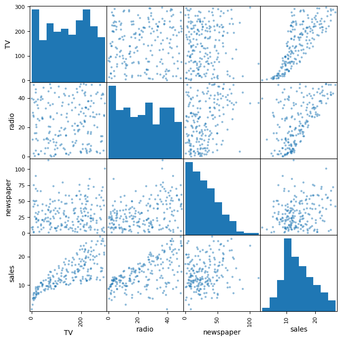
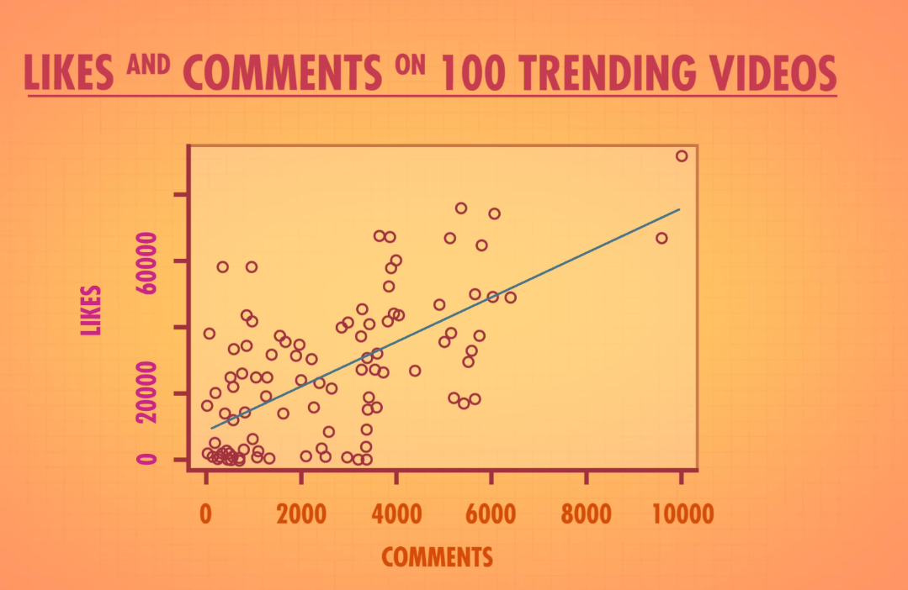
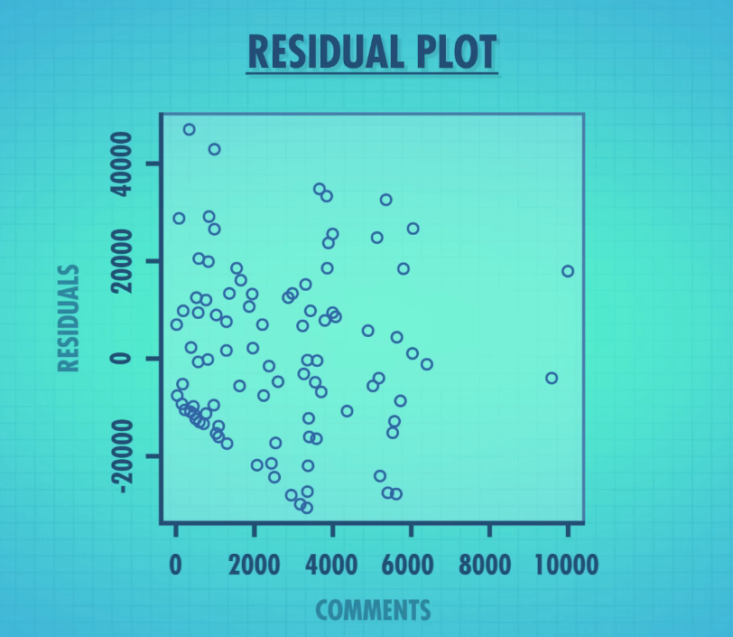
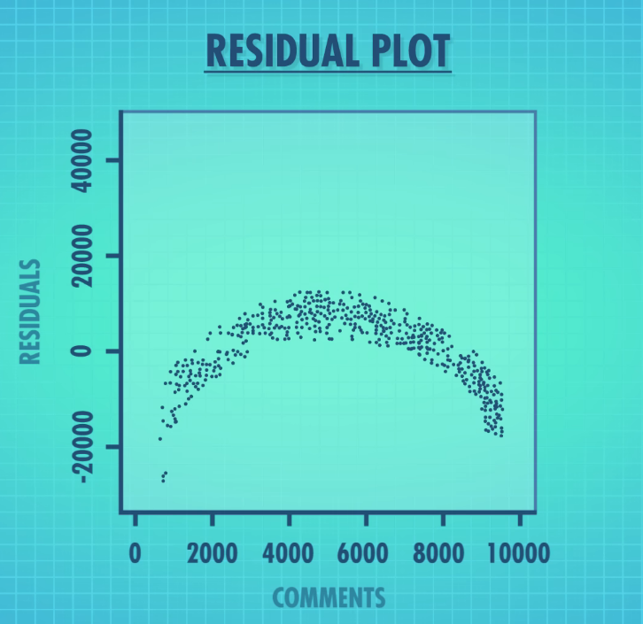

## Today's Outline
- Correlation and Regression review
- Announcements
- Quick Poll
- Work time

## Correlation and Regression Review
```{=html}
<a href="./Advertising.csv" download> Advertising dataset </a>
```

- TV: advertising dollars spent on TV for a single product in a given market (in thousands of dollars)
- Radio: advertising dollars spent on Radio
- Newspaper: advertising dollars spent on Newspaper
- Sales: sales of a single product in a given market (in thousands of units)

## Why use scatterplot matrices
- Quick glance at correlation, trends, and outliers
[](https://www.data-to-viz.com/graph/correlogram.html)

## How to create it in
- PowerBI
- Tableau

## Example


## Histograms: Distribution
- Histograms show the distribution on the diagonal
    - Distribution: frequency of values in a dataset
    - Normal/Symmetric? Many values near the centre
    - Uniform? The frequency of values are about the same, looks boxy
    - Right/Left skewed? Values are mostly low or high
    - Bimodal? (two peaks) There could be two unique distributions

## Histograms: Skewness
- Skewness
    - Positive Skew: mean > median
    - Negative Skew: mean < median
    - No skew: mean = median = mode

## Correlation Coefficient
- All the data points get represented as a single value
- Pearson's *r* measures the strength and direction of a **linear** relationship
- Ranges from -1 to +1
    - **+1**: perfect positive (as X goes up, Y goes up)
    - **0**: no linear relationship
    - **-1**: perfect negative (as X goes up, Y goes down)
- Rough guide: |r| < 0.3 weak, 0.3 to 0.7 moderate, > 0.7 strong
- Let's do it in Excel!

::: {.notes}
Explain correlation first: one number summarizing how tightly the points hug a line.
Remind them correlation is not causation, and that r only captures linear patterns
(a perfect U-shape can have r near 0).
Negative means that as x feature goes up, then the y value decreases
:::

## Correlation Matrix: Advertising Data
| | TV | Radio | Newspaper | Sales |
|---|---|---|---|---|
| **TV** | 1.00 | 0.05 | 0.06 | **0.78** |
| **Radio** | 0.05 | 1.00 | 0.35 | **0.58** |
| **Newspaper** | 0.06 | 0.35 | 1.00 | **0.23** |
| **Sales** | 0.78 | 0.58 | 0.23 | 1.00 |

- TV has the strongest relationship with Sales
- Newspaper has only a weak relationship with Sales
- Radio and Newspaper are moderately correlated with each other

## Heatmap for Correlation
- A heatmap turns the matrix into colour so patterns pop out
- In Excel: select the matrix → Home → Conditional Formatting → **Color Scales**
- Dark = strong, light = weak
- Look for:
    - Strong correlations with the target (Sales)
    - Strong correlations *between predictors* (multicollinearity)
- PowerBI

::: {.notes}
Show the heatmap after the numeric matrix so they can connect the colours to the values.
Point out that Radio and Newspaper are correlated, which may matter later.
:::

## From Correlation to Regression
- Correlation: *how strongly* are two variables related?
- Regression: *what is the relationship*, and can we **predict** with it?
- Simple linear regression:

$$\hat{y} = \beta_0 + \beta_1 x$$

- $\beta_0$ is the intercept: predicted Sales when spend is 0
- $\beta_1$ is the slope: change in Sales for each additional unit of spend
- The "best" line minimizes the sum of squared residuals (least squares)

## Which Line Is "Best"?
- Many lines could be drawn through the data
- Each point misses the line by some amount: its **residual**
- Square the misses and add them up to score a line
- Squaring stops over- and under-predictions from cancelling out
- The **least squares line** has the smallest total score

## Regression Chart


## Residuals: What the Line Gets Wrong
- Residual = actual value − predicted value

$$e_i = y_i - \hat{y}_i$$

- Positive residual: the line **under**-predicted
- Negative residual: the line **over**-predicted
- Least squares picks the line that makes this as small as possible:

## Residual Plots


## Residual Plots


## Regression Statistics in Excel
- The Output Has Three Sections
1. **Regression Statistics**
    - How well does the model fit?
2. **ANOVA**
    - I'm going to skip this
3. **Coefficients**
    - What does each variable do, and can we trust it?

## Multiple R
- **Multiple R** = 0.947212034
- How strongly the predictors, taken together, relate to Sales
- If only one predictor, it's the same as the correlation coefficient
- Closer to 1 means a stronger relationship

## R Square (R²)
- **R Square** = 0.897210638
- Proportion of variance in response variable (Sales) using the predictor variables (TV, Radio, Newspaper)
    - Value of 1 => variability in response can be explained by predictors
    - Value of 0 => variability in response cannot be explained by predictors

::: {.notes}
Common mistake: R² of 0.61 does not mean the predictions are 61% accurate.
It means 61% of the variation in Sales is accounted for.
R² never goes down when you add variables, which is why adjusted R² exists.
0.6 is strong in marketing, but would be weak in physics.
:::

## Standard Error
- **Standard Error** = 1.685510373
- The typical size of a prediction miss, **in the units of Sales**
- Smaller is better

::: {.notes}
Standard error is often more useful than R² for judging practical accuracy,
because it's in real units. Roughly 95% of actual values fall within two standard errors of the prediction.
:::

## Section 3: Coefficients {.smaller}

| | Coefficients | Standard Error | t Stat | P-value | Lower 95% | Upper 95% |
|---|---|---|---|---|---|---|
| **Intercept** | 2.939 | 0.312 | 9.42 | < 0.001 | 2.324 | 3.554 |
| **TV** | 0.0458 | 0.0014 | 32.81 | < 0.001 | 0.0430 | 0.0485 |
| **Radio** | 0.1885 | 0.0086 | 21.89 | < 0.001 | 0.1715 | 0.2055 |
| **Newspaper** | -0.0010 | 0.0059 | -0.18 | 0.860 | -0.0126 | 0.0105 |

## Coefficients: The Effect
- **Intercept** = 2.939
    - Predicted Sales when \$0 is spent on all three media of advertising (about 2,900 units)
- **TV** = 0.0458
    - For each extra \$1,000 spent on TV ads, we predict that about 46 more units sold
- **Radio** = 0.1885
    - Each each extra \$1,000 spent on radio ads, we predict that about 189 more units sold
- These values are if other variables are constant
- This doesn't mean that radio is better than TV

::: {.notes}
Spend is in thousands of dollars and Sales is in thousands of units, so 0.0458 means 45.8 units per \$1,000.
Radio returns roughly 4x as many units per dollar as TV.
The intercept is an extrapolation if no market has \$0 spend on all three media.
:::

## Coefficients: Newspaper
- **Newspaper** = -0.0010
    - Essentially zero, and slightly negative
- Each extra \$1,000 on newspaper goes with about 1 *fewer* unit
    - Too small to matter
- The **sign** shows direction and the **size** shows strength

::: {.notes}
Don't read the negative sign as "newspaper ads hurt sales." The estimate is statistically indistinguishable from zero,
as the p-value and confidence interval will show.
:::

## Coefficients: Can We Trust It?
- **Standard Error**: how much the estimate would wobble with different data
    - Small relative to the coefficient means a precise estimate
- **t Stat**: the coefficient measured in standard errors
    - Rule of thumb: |t| > 2 is significant
    - TV: 32.8, Radio: 21.9, Newspaper: **-0.18**

## P-Value
- indicates how likely a statistical result occured by chance
- small p value:
    - statistically significant, unlikely to be chance alone
    - accept alternative hypothesis
    - Alternative hypothesis: theory you are trying to prove
- high p value:
    - statistically non-significant, likely to be chance
    - failed to reject null-hypothesis
    - Null hypothesis: theory you are trying to disprove
- p-values range from: 0 - 0.1

::: {.notes}
Newspaper's standard error (0.0059) is much larger than its coefficient (0.0010), so the t stat is near 0.
A p-value of 0.86 means that if newspaper truly had no effect, we'd see an estimate this size
about 86% of the time just by chance.
:::

## Coefficients: Confidence Interval
- **Lower / Upper 95%**: the range of plausible values for the true effect
- **TV**: 0.043 to 0.049
    - Each \$1,000 adds between 43 and 49 units
- **Radio**: 0.172 to 0.206
    - Each \$1,000 adds between 172 and 206 units
- **Newspaper**: -0.013 to 0.011
    - The range **includes 0**, so we can't rule out no effect


::: {.notes}
Newspaper's "no effect" means no added value *given TV and Radio are already in the model*.
It doesn't prove newspaper ads never work.
Newspaper looked related to Sales in the correlation matrix (r = 0.23) only because it correlates with Radio (r = 0.35).
The key is whether the interval includes zero:
- TV: Its interval is entirely positive, supporting a positive coefficient.
- Radio: Its interval is entirely positive, also supporting a positive coefficient.
- Newspaper: Its interval includes zero, meaning the true coefficient could be negative, zero, or positive under the model.
:::

## Key Takeaways
- Scatterplot matrices give a quick visual of trends, distributions, and outliers
- Correlation (*r*) summarizes the strength and direction of a linear relationship
- Heatmaps make a correlation matrix easy to scan
- Regression quantifies the relationship and enables prediction

## Questions?

## Announcements
- Assignment 8: Group focused
- Quick Poll re Wednesday:
- livepoll.io/join
    - Code: A8Q8HE


## Some resources:
[Simple Distribution YouTube Video](https://www.youtube.com/watch?v=pLQ9RPj6TYE)

[YouTube Crash Course Regression](https://www.youtube.com/watch?v=WWqE7YHR4Jc)